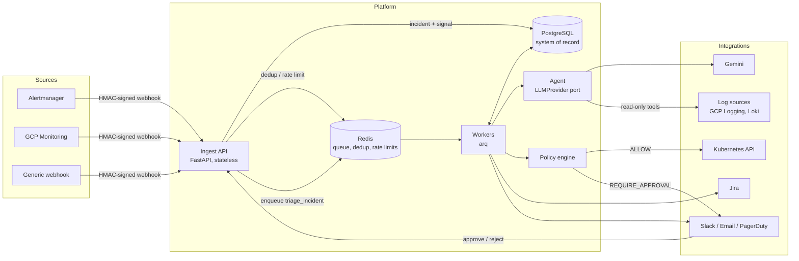

# Architecture

Production design for Agent Triage. Decisions and rationale are in [`adr/`](adr/README.md).

## Overview

## Request and job flow

1. **Ingest** (`POST /v1/alerts/{source}`): verify signature → normalize to `AlertSignal` → compute fingerprint →
   in one transaction either attach to the open incident with that fingerprint or create a new `NEW` incident →
   enqueue `triage_incident(incident_id)` for new incidents → `202 {incident_id}`.
2. **Triage job**: `NEW → TRIAGING`; agent gathers evidence via read-only tools and returns a validated
   `TriageResult`; worker creates/updates the Jira ticket; state machine picks the next state:
   - Tier 1 and policy `ALLOW` → `REMEDIATING` → enqueue `execute_remediation`
   - Tier 2 or policy `REQUIRE_APPROVAL` → `AWAITING_APPROVAL` → Slack/email approval request + `expire_approval` deferred job
   - Tier 3, policy `DENY`, or agent failure → `ESCALATED` → page on-call
3. **Approval**: signed callback → `REMEDIATING` (approved). A rejection needs a reason and does not page:
   `false_positive` → `SUPPRESSED`, `handle_manually` → `MANUAL`, `wrong_action` → re-triage once. Only an
   unanswered approval that expires → `ESCALATED` (see ADR 0006).
4. **Remediation job**: executes the typed action via the Kubernetes executor (or records it in `dry_run`) →
   `VERIFYING` → deferred `verify_remediation`.
5. **Verification job**: re-checks signals/logs → `RESOLVED` or `ESCALATED`.

Every transition appends to `incident_events`, which is the audit log and the source for the timeline API.

## Components

| Component | Responsibility | Scaling |
|-----------|----------------|---------|
| Ingest API | Auth, validation, normalization, dedup, enqueue, read APIs | Stateless; HPA on CPU |
| Workers | Triage, remediation, verification, notifications, timeouts | HPA on queue depth |
| PostgreSQL | Incidents, signals, timeline, actions, approvals, agent runs | Cloud SQL (HA) |
| Redis | Job queue, dedup window, rate limits | Memorystore (HA); no durable data |
| Policy engine | Evaluate typed actions against YAML policy | In-process library |
| Agent | Evidence gathering + structured RCA via `LLMProvider` | Runs inside workers |

## Delivery phases

1. **Core platform** — new layout, settings, ingest API, Postgres models + migrations, arq workers, dedup,
   state machine, mocked integration ports, docker-compose, CI.
2. **Agent + integrations** — `LLMProvider` (Gemini), prompts, evals, real Jira/Slack/email/log adapters, approval flow.
3. **Remediation + ops** — policy engine, Kubernetes executor, verification, OpenTelemetry, metrics, Helm chart.
4. **Dashboard** — React operator UI.

The first Phase 2 slice offers opt-in, single-call Gemini analysis of bounded alert evidence. It records the result
and escalates for operator review. See [ADR 0012](adr/0012-gemini-analysis-rollout.md) for the rollout scope.
