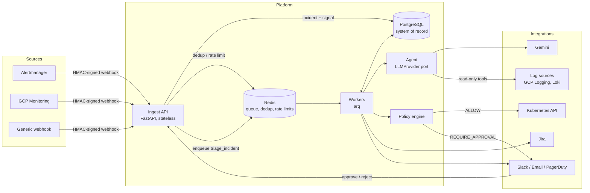

# Architecture

Production design for Agent Triage. Decisions and rationale are in [`adr/`](adr/README.md).

## Overview

## Request and job flow

1. **Ingest** (`POST /v1/alerts/{source}`): verify signature → normalize to `AlertSignal` → compute fingerprint →
   in one transaction either attach to the open incident with that fingerprint or create a new `NEW` incident →
   enqueue `triage_incident(incident_id)` for new incidents → `202 {incident_id}`.
2. **Triage job**: `NEW → TRIAGING`; agent gathers evidence via read-only tools and returns a validated
   `TriageResult`; worker creates/updates the Jira ticket; state machine picks the next state:
   - Tier 1 and policy `ALLOW` → `REMEDIATING` → enqueue `execute_remediation`
   - Tier 2 or policy `REQUIRE_APPROVAL` → `AWAITING_APPROVAL` → Slack/email approval request + `expire_approval` deferred job
   - Tier 3, policy `DENY`, or agent failure → `ESCALATED` → page on-call
3. **Approval**: signed callback → `REMEDIATING` (approved). A rejection needs a reason and does not page:
   `false_positive` → `SUPPRESSED`, `handle_manually` → `MANUAL`, `wrong_action` → re-triage once. Only an
   unanswered approval that expires → `ESCALATED` (see ADR 0006).
4. **Remediation job**: executes the typed action via the Kubernetes executor (or records it in `dry_run`) →
   `VERIFYING` → deferred `verify_remediation`.
5. **Verification job**: finds the action's execution event on the incident timeline and counts firing signals attached
   after it. Zero resolves the incident. A later firing signal or a missing execution event escalates it. Ingest and
   action completion hold the same incident row lock when recording these events, so verification follows their order
   even when worker and database clocks differ.

Every transition appends to `incident_events`, which is the audit log and the source for the timeline API.

## Components

| Component | Responsibility | Scaling |
|-----------|----------------|---------|
| Ingest API | Auth, validation, normalization, dedup, enqueue, read APIs | Stateless; HPA on CPU |
| Workers | Triage, remediation, verification, notifications, timeouts | HPA on queue depth |
| PostgreSQL | Incidents, signals, timeline, actions, approvals, agent runs | Cloud SQL (HA) |
| Redis | Job queue, dedup window, rate limits | Memorystore (HA); no durable data |
| Policy engine | Evaluate typed actions against YAML policy | In-process library |
| Agent | Evidence gathering + structured RCA via `LLMProvider` | Runs inside workers |

## Delivery phases

1. **Core platform** — new layout, settings, ingest API, Postgres models + migrations, arq workers, dedup,
   state machine, mocked integration ports, docker-compose, CI.
2. **Agent + integrations** — `LLMProvider` (Gemini), prompts, evals, real Jira/Slack/email/log adapters, approval flow.
3. **Remediation + ops** — policy engine, Kubernetes executor, verification, OpenTelemetry, metrics, Helm chart.
4. **Dashboard** — Opt-in operator UI for incidents, approval decisions, and API dependency readiness.
   The independently deployed frontend proxies dashboard requests to the API on the same browser origin.
   See [ADR 0018](adr/0018-standalone-dashboard.md) for deployment and [ADR 0017](adr/0017-dashboard-rbac.md) for access.

The first Phase 3 slice packages the API, worker, and migrations for Kubernetes. See the
[Helm deployment guide](../deploy/helm/README.md) for environment profiles and cluster prerequisites.

The first Phase 2 slice offers opt-in, single-call Gemini analysis of bounded alert evidence. It records the result
and escalates for operator review. See [ADR 0012](adr/0012-gemini-analysis-rollout.md) for the rollout scope.

The Slack notifier posts incident IDs, severity, and lifecycle event labels to a configured channel. Operators use the
authenticated incident API for approvals. See [ADR 0013](adr/0013-slack-webhook-notifications.md).

The Resend email notifier uses the queued job ID to deduplicate delivery retries and sends the incident ID and event
label to a configured address. See [ADR 0014](adr/0014-resend-email-notifications.md).

The Jira Cloud adapter reserves one create attempt per incident and reconciles uncertain results by incident label.
See [ADR 0015](adr/0015-jira-cloud-ticketing.md).
